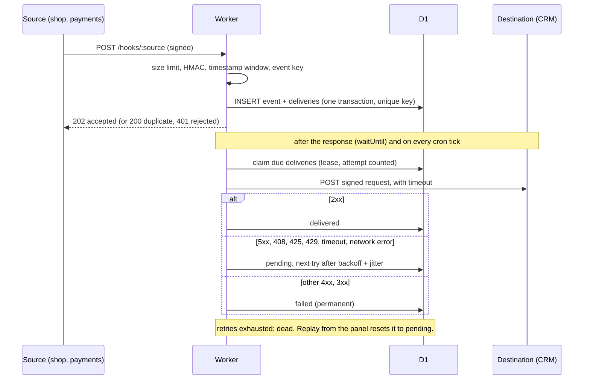

# webhook-relay

A small Cloudflare Worker that receives webhooks from external systems (payments, a shop, forms), verifies them, stores them exactly once, and forwards them to your own systems with retries, a dead-letter state, and a panel where you can see what happened.

It is a portfolio project that shows how I think about reliability in integrations. It is small on purpose: everything is TypeScript, runs on one Worker plus one D1 database, and needs no external services.


## The problem

**For a business owner.** Your shop, payment provider or form tool tells your other systems "an order was paid" by sending a message over the internet. If your CRM or accounting system is down for five minutes at that moment, the message is simply lost, and nobody notices until a customer complains. Providers also send the same message twice from time to time, which can mean a double invoice. And anyone who guesses the address can send you fake "paid" messages.

This service sits in the middle. It accepts the message, checks that it is genuine, writes it down, answers the sender immediately, and then keeps trying to hand it over until your system accepts it. If something cannot be delivered at all, it is kept and shown in a panel, and you can send it again with one click.

**For an engineer.** Inbound webhook handling with: HMAC verification on the raw body in constant time, optional replay protection with a signed timestamp, idempotency enforced by a unique index, an ack that does not depend on delivery, at-least-once delivery with exponential backoff and jitter, transient/permanent error classification, a dead-letter state with manual replay, and an inspectable attempt history.

## Flow



Delivery states: `pending` (waiting for a first or next attempt), `delivered`, `failed` (permanent error, retrying would not help), `dead` (retries exhausted). The status of an event is the worst status of its deliveries (dead, failed, pending, delivered).

## Decisions and trade-offs

**D1 + cron instead of a queue.** I checked the current Cloudflare Queues pricing page: Queues is listed for the Workers Free plan too (10,000 operations per day included, messages kept for 24 hours, non-configurable). So cost was not the deciding factor. I still chose a table plus a cron trigger because:
- the delivery state has to be queryable anyway (panel, filtering by status, attempt history), so a table is needed either way;
- a dead-letter that has to wait for a human can outlive a 24 hour retention window, while a row in D1 stays until deleted;
- storing the event and its deliveries in one D1 transaction, protected by a unique index, makes "accepted exactly once" simple to reason about, with no gap between "written to the database" and "enqueued";
- one moving part less to run and explain.

The cost: the cron trigger runs at most once a minute, so a retry is picked up up to about a minute after it is due (the first attempt is not affected, see below). A queue would give lower retry latency and better fan-out at higher volume. If volume grew, I would put a queue in front of delivery and keep D1 as the system of record.

**Fast acknowledgement.** The request handler verifies and stores the event, answers, and starts the first delivery attempt after the response with `ctx.waitUntil`. The sender never waits for your CRM. If the invocation is cut short, the cron trigger finds the pending delivery.

**At-least-once, not exactly-once.** A delivery can be sent twice, for example if the destination processed a request but the response never arrived, or if a Worker was evicted between sending and recording the result. Exactly-once over HTTP is not achievable, so the relay is explicit about it: every outgoing request carries `Idempotency-Key` (and `X-Relay-Event-Id`) so the receiver can ignore repeats. What the relay does guarantee is that the same inbound event does not create a second set of deliveries.

**Idempotency.** Each source declares where its event key lives: a header (`x-event-id`) or a JSON path (`id`). The pair `(source, event_key)` has a unique index. A repeated event gets `200 {"result":"duplicate"}` and no new delivery. If a source configures no key location, the key is a hash of the raw body, which only catches byte-identical retransmissions. If a configured key is missing, the request is rejected with 400.

**Ordering.** There is no ordering guarantee. Events are handled independently, and a retried event arrives after later ones. Receivers should use timestamps or version numbers in the payload, or fetch current state from the source of truth.

**Crash safety.** Claiming a delivery pushes `next_attempt_at` forward (a lease) and counts the attempt in one atomic statement. If the Worker dies mid-attempt, the delivery becomes due again after the lease. Because the attempt is counted at claim time, a payload that crashes the Worker repeatedly still ends up dead instead of looping forever.

## Security model

- **Signature.** HMAC-SHA256 over the raw body bytes as received (before any parsing), compared in constant time. Each source has its own secret, stored as a Worker secret named `SOURCE_<NAME>_SECRET`. A missing secret makes the source unavailable (404), not open.
- **Replay protection.** Sources with a `timestampHeader` sign `"<timestamp>.<body>"`, so the timestamp cannot be changed without invalidating the signature. Requests outside the tolerance window (default 300 seconds) are rejected. Sources without a timestamp rely on the idempotency key: a replayed event is a duplicate and has no effect.
- **Limits.** Request body is limited (`MAX_BODY_BYTES`, default 262144), enforced while streaming, so a missing or false `Content-Length` does not bypass it. Event keys are limited to 200 characters. Only `POST` is accepted on hook URLs.
- **Outgoing requests** are signed with a per-destination secret (`x-relay-signature: sha256=...` over `"<timestamp>.<body>"`). Redirects are not followed. Destination URLs come from configuration, must be `https`, and plain `http` is accepted only for `localhost` / `127.0.0.1` (local development).
- **Admin.** `Authorization: Bearer <ADMIN_TOKEN>`, compared via SHA-256 digests in constant time. The panel page itself contains no data; it asks for the token and keeps it only in a JavaScript variable (not in storage, cookies or URLs). All data is inserted with `textContent`. The page is served with a nonce-based CSP, `no-store`, and no external resources.
- **Secrets** are never in the repository. `.dev.vars` is git-ignored; `.dev.vars.example` contains throwaway values for local use only.

## Limitations

- Not load tested. I make no claims about throughput. Each cron run handles at most `BATCH_SIZE` deliveries (default 10), delivered with a concurrency of 5, so bursts are drained over several runs. Check Cloudflare's current Workers and D1 limits for your plan before relying on it.
- Retry latency is bounded below by the cron interval (one minute).
- No ordering guarantee (see above), and at-least-once delivery.
- No rate limiting of invalid requests in the Worker. Use a Cloudflare rate limiting rule in front of `/hooks/*` if you expose it publicly.
- No retention or cleanup of old events. Add a scheduled `DELETE` if the table should not grow.
- Destinations are plain HTTP POST with the original JSON body; there is no transformation or per-destination filtering.
- The admin token is a single shared secret. For anything beyond a small team, put the panel behind Cloudflare Access.
- Failed signature checks are not stored, so the panel does not show them.

## Run locally

Requirements: Node.js (developed and tested with v22).

```bash
npm ci
cp .dev.vars.example .dev.vars     # local throwaway secrets
npm run db:migrate:local           # creates the local D1 database
npm run dev                        # worker on http://127.0.0.1:8787
```

In a second terminal:

```bash
npm run demo
```

The demo starts a fake CRM on port 9100 that answers 500 three times per event and then 200, sends signed events (one valid, one duplicate, one with a wrong signature, one with a stale timestamp, one from a second source) and prints the result. The real output of a run is in [`docs/demo-output.txt`](docs/demo-output.txt). Open http://127.0.0.1:8787/ and enter `dev-admin-token` to see the panel.

Local cron: `wrangler dev` does not fire the schedule by itself. The demo triggers the scheduled handler through `GET /cdn-cgi/handler/scheduled`, which needs the `--test-scheduled` flag. `npm run dev` already passes that flag.

Scripts: `npm test`, `npm run typecheck`, `npm run dev`, `npm run demo`, `npm run db:migrate:local`, `npm run deploy`.

### Admin API

```bash
TOKEN=dev-admin-token
curl -H "Authorization: Bearer $TOKEN" "http://127.0.0.1:8787/admin/events?status=dead&limit=20"
curl -H "Authorization: Bearer $TOKEN" http://127.0.0.1:8787/admin/events/<id>
curl -X POST -H "Authorization: Bearer $TOKEN" http://127.0.0.1:8787/admin/events/<id>/replay
```

Replay resets the failed and dead deliveries of an event to `pending` with a fresh attempt budget (attempt history is kept) and returns `202`; if there is nothing to replay it returns `409`.

## Deploy

```bash
npx wrangler login
npx wrangler d1 create webhook-relay          # put the printed id in wrangler.jsonc (database_id)
npm run db:migrate:remote
npx wrangler secret put ADMIN_TOKEN
npx wrangler secret put SOURCE_SHOP_SECRET
npx wrangler secret put SOURCE_PAYMENTS_SECRET
npx wrangler secret put DEST_CRM_SECRET
npx wrangler secret put DEST_CRM_URL          # https://...
npm run deploy
```

The cron trigger (`* * * * *`) is part of `wrangler.jsonc`. I have not deployed this project, so the remote steps above are unverified; the local run is.

## Adding a source or a destination

Edit [`src/config.ts`](src/config.ts).

```ts
// a new source
stripe: {
  secretEnv: "SOURCE_STRIPE_SECRET",
  signatureHeader: "x-signature",
  idempotency: { jsonPath: "id" },      // or { header: "x-event-id" }
  destinations: ["crm", "accounting"],
},
// a new destination
accounting: { urlEnv: "DEST_ACCOUNTING_URL", secretEnv: "DEST_ACCOUNTING_SECRET" },
```

Then set the matching secrets (`wrangler secret put ...`) and deploy. The source sends webhooks to `POST /hooks/stripe`. The signature scheme is "hex HMAC-SHA256 of the raw body" (optionally `sha256=` prefixed), or of `"<timestamp>.<body>"` when `timestampHeader` is set. Providers with a different scheme need a small adapter in `src/core/signature.ts`.

## Tests

`npm test` runs offline unit tests (Vitest) on the pure logic: signatures (including an RFC 4231 test vector), timestamp window, backoff, status classification, state transitions, event key extraction, and the whole ingest and delivery flow against an in-memory fake repository (deduplication, retries, permanent failures, dead-letter, replay, lease behaviour, timeouts).

The D1 repository is not covered by automated tests. I verified it by hand against a real local D1 database through `wrangler dev` (migrations, ingest, duplicate handling, retries, dead state, replay, admin API); see [`docs/demo-output.txt`](docs/demo-output.txt) for one such run. The real Cloudflare cron trigger and a remote deployment were not verified.

## Layout

```
src/core/      pure logic: signature, backoff, classify, state, idempotency, ingest, deliver
src/d1repo.ts  D1 implementation of the repository interface
src/index.ts   Worker: routing, size limit, admin API, scheduled handler
src/panel.ts   admin panel (one HTML page)
src/config.ts  sources and destinations
migrations/    D1 schema
test/          unit tests and the in-memory repository
scripts/       demo
```

## License

MIT, see [LICENSE](LICENSE).
