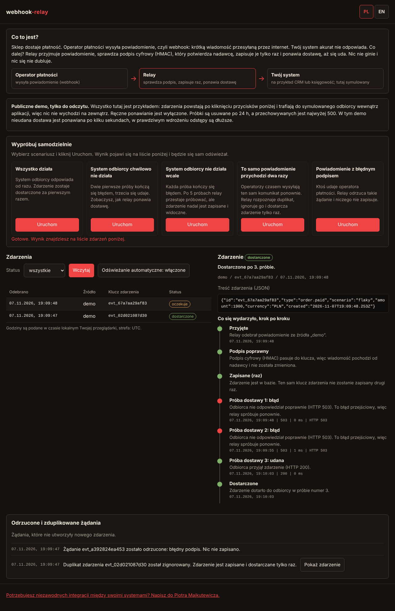
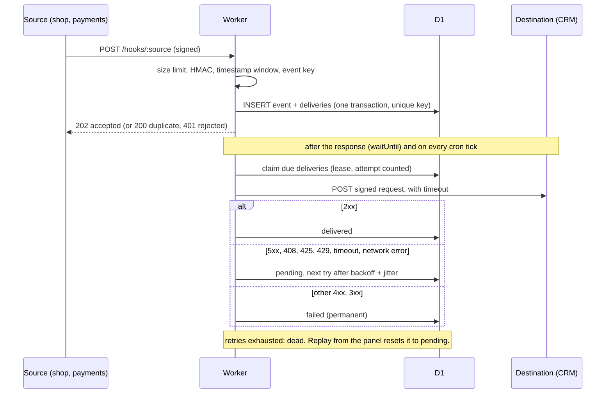

# webhook-relay

A small Cloudflare Worker that receives webhooks from external systems (payments, a shop, forms), verifies them, stores them exactly once, and forwards them to your own systems with retries, a dead-letter state, and a panel where you can see what happened.

It is a portfolio project that shows how I think about reliability in integrations. It is small on purpose: everything is TypeScript, runs on one Worker plus one D1 database, and needs no external services.



## Live demo

The demo is intended to run at **https://relay.piotrmajkutewicz.pl**. It is only live after the deployment steps in [Deploying the demo](#deploying-the-demo) have been done; until then the address does not exist. Nothing in this repository has been deployed yet.

In the demo you can press "Send a sample event", watch it arrive, fail, be retried and (depending on the scenario) be delivered or end up dead. The panel is read-only. The demo is deliberately **not indexed by search engines** (see [Demo mode and threat model](#demo-mode-and-threat-model)).

## The problem

**For a business owner.** Your shop, payment provider or form tool tells your other systems "an order was paid" by sending a message over the internet. If your CRM or accounting system is down for five minutes at that moment, the message is simply lost, and nobody notices until a customer complains. Providers also send the same message twice from time to time, which can mean a double invoice. And anyone who guesses the address can send you fake "paid" messages.

This service sits in the middle. It accepts the message, checks that it is genuine, writes it down, answers the sender immediately, and then keeps trying to hand it over until your system accepts it. If something cannot be delivered at all, it is kept and shown in a panel, and you can send it again with one click.

**For an engineer.** Inbound webhook handling with: HMAC verification on the raw body in constant time, optional replay protection with a signed timestamp, idempotency enforced by a unique index, an ack that does not depend on delivery, at-least-once delivery with exponential backoff and jitter, transient/permanent error classification, a dead-letter state with manual replay, and an inspectable attempt history.

## Flow



Delivery states: `pending` (waiting for a first or next attempt), `delivered`, `failed` (permanent error, retrying would not help), `dead` (retries exhausted). The status of an event is the worst status of its deliveries (dead, failed, pending, delivered).

## Languages

The panel (normal and demo mode) is **Polish by default**, whatever the browser's language is, and has a PL / EN switch in the header.
- `?lang=pl` or `?lang=en` in the URL takes precedence and is saved.
- Otherwise the saved choice is used (`localStorage` key `relay.lang`; the page works without it if storage is blocked), then Polish.
- `<html lang>` follows the chosen language. The switch is a pair of buttons with `aria-pressed`, usable from the keyboard, 44 px touch targets. Switching re-renders from the data already on screen, so the selected event, the status filter and auto-refresh are not reset and no request is made.
- All texts live in two dictionaries, [`src/i18n/pl.ts`](src/i18n/pl.ts) and [`src/i18n/en.ts`](src/i18n/en.ts). A key missing in one of them is a compile error, and a test checks that no text is empty and that placeholders match. The dictionaries are passed to the page as inert JSON (a non-executed script block) and applied with `textContent`; the CSP is unchanged.
- The JSON API is not translated: field names, statuses (`pending`, `delivered`, `failed`, `dead`), outcomes and error messages stay the same in every language, and the panel maps the stable identifiers to labels. Event data (payload, attempt errors such as `HTTP 503`) is shown as received.
- **Time zone decision:** times are shown in the browser's local time zone, formatted for the chosen language (Polish `pl-PL`, English `en-GB`; both 24 hour), and the zone name is printed under the table (for example `Europe/Warsaw`) so there is no ambiguity. I preferred this over fixed UTC because visitors read "when did this happen" against their own clock; the API still returns epoch milliseconds.

## Decisions and trade-offs

**D1 + cron instead of a queue.** I checked the current Cloudflare Queues pricing page: Queues is listed for the Workers Free plan too (10,000 operations per day included, messages kept for 24 hours, non-configurable). So cost was not the deciding factor. I still chose a table plus a cron trigger because:
- the delivery state has to be queryable anyway (panel, filtering by status, attempt history), so a table is needed either way;
- a dead-letter that has to wait for a human can outlive a 24 hour retention window, while a row in D1 stays until deleted;
- storing the event and its deliveries in one D1 transaction, protected by a unique index, makes "accepted exactly once" simple to reason about, with no gap between "written to the database" and "enqueued";
- one moving part less to run and explain.

The cost: the cron trigger runs at most once a minute, so a retry is picked up up to about a minute after it is due (the first attempt is not affected, see below). A queue would give lower retry latency and better fan-out at higher volume. If volume grew, I would put a queue in front of delivery and keep D1 as the system of record.

**Fast acknowledgement.** The request handler verifies and stores the event, answers, and starts the first delivery attempt after the response with `ctx.waitUntil`. The sender never waits for your CRM. If the invocation is cut short, the cron trigger finds the pending delivery.

**At-least-once, not exactly-once.** A delivery can be sent twice, for example if the destination processed a request but the response never arrived, or if a Worker was evicted between sending and recording the result. Exactly-once over HTTP is not achievable, so the relay is explicit about it: every outgoing request carries `Idempotency-Key` (and `X-Relay-Event-Id`) so the receiver can ignore repeats. What the relay does guarantee is that the same inbound event does not create a second set of deliveries.

**Idempotency.** Each source declares where its event key lives: a header (`x-event-id`) or a JSON path (`id`). The pair `(source, event_key)` has a unique index. A repeated event gets `200 {"result":"duplicate"}` and no new delivery. If a source configures no key location, the key is a hash of the raw body, which only catches byte-identical retransmissions. If a configured key is missing, the request is rejected with 400.

**Ordering.** There is no ordering guarantee. Events are handled independently, and a retried event arrives after later ones. Receivers should use timestamps or version numbers in the payload, or fetch current state from the source of truth.

**Crash safety.** Claiming a delivery pushes `next_attempt_at` forward (a lease) and counts the attempt in one atomic statement. If the Worker dies mid-attempt, the delivery becomes due again after the lease. Because the attempt is counted at claim time, a payload that crashes the Worker repeatedly still ends up dead instead of looping forever.

## Security model

- **Signature.** HMAC-SHA256 over the raw body bytes as received (before any parsing), compared in constant time. Each source has its own secret, stored as a Worker secret named `SOURCE_<NAME>_SECRET`. A missing secret makes the source unavailable (404), not open.
- **Replay protection.** Sources with a `timestampHeader` sign `"<timestamp>.<body>"`, so the timestamp cannot be changed without invalidating the signature. Requests outside the tolerance window (default 300 seconds) are rejected. Sources without a timestamp rely on the idempotency key: a replayed event is a duplicate and has no effect.
- **Limits.** Request body is limited (`MAX_BODY_BYTES`, default 262144), enforced while streaming, so a missing or false `Content-Length` does not bypass it. Event keys are limited to 200 characters. Only `POST` is accepted on hook URLs.
- **Outgoing requests** are signed with a per-destination secret (`x-relay-signature: sha256=...` over `"<timestamp>.<body>"`). Redirects are not followed. Destination URLs come from configuration, must be `https`, and plain `http` is accepted only for `localhost` / `127.0.0.1` (local development).
- **Admin.** `Authorization: Bearer <ADMIN_TOKEN>`, compared via SHA-256 digests in constant time. The panel page itself contains no data; it asks for the token and keeps it only in a JavaScript variable (not in storage, cookies or URLs). All data is inserted with `textContent`. The page is served with a nonce-based CSP, `no-store`, and no external resources.
- **Secrets** are never in the repository. `.dev.vars` is git-ignored; `.dev.vars.example` contains throwaway values for local use only.

## Limitations

- Not load tested. I make no claims about throughput. Each cron run handles at most `BATCH_SIZE` deliveries (default 10), delivered with a concurrency of 5, so bursts are drained over several runs. Check Cloudflare's current Workers and D1 limits for your plan before relying on it.
- Retry latency is bounded below by the cron interval (one minute).
- No ordering guarantee (see above), and at-least-once delivery.
- Abuse protection exists only in demo mode, and only for creating sample events (per-client and global limits in D1). In normal mode there is no rate limiting of invalid requests in the Worker; use a Cloudflare rate limiting rule in front of `/hooks/*` if you expose it publicly. In demo mode reads of the panel API are not limited by the Worker either (see "What this does not cover").
- Retention exists only in demo mode (24 hour TTL and a cap of 500 events, run by cron). In normal mode events are kept until deleted by hand; add a scheduled `DELETE` if the table should not grow.
- Destinations are plain HTTP POST with the original JSON body; there is no transformation or per-destination filtering.
- The admin token is a single shared secret. For anything beyond a small team, put the panel behind Cloudflare Access.
- Failed signature checks are not stored, so the panel does not show them.

## Demo mode and threat model

`DEMO_MODE=true` is a wrangler var that is set only in the `env.demo` block of `wrangler.jsonc`. It is off by default, and only the exact string `true` turns it on. With it off, nothing described here exists: the admin API keeps requiring the Bearer token, `/hooks/*` works as before, and `/demo/sample` returns 404.

**What a visitor can do**
- Open the panel without a token and read events, deliveries and attempts (`GET /admin/events`, `GET /admin/events/:id`).
- Create sample events with `POST /demo/sample`, choosing only one of three scenarios: `flaky` (the destination fails twice, then succeeds), `ok`, or `down` (always fails, ends up dead after 5 attempts).

**What a visitor cannot do**
- Replay or change anything. In demo mode the admin API accepts `GET` only; every other method and the replay path return 403, even with a valid admin token. There is no endpoint that changes configuration (sources and destinations live in code).
- Send their own payload. The server builds the whole event (fixed shape, about 150 bytes, a few fixed values). The request body is limited to 256 bytes and may contain only `{"scenario": "..."}`; any other key or value is a 400.
- Post to `/hooks/*`. Those routes return 404 in demo mode, so the public cannot write arbitrary data even in principle.
- Choose a destination. In demo mode the Worker never calls `fetch` for deliveries: the only destination is a function inside the Worker that answers from the attempt number and the scenario. No URL is read from config or from a user, so the demo cannot be used for SSRF, port scanning or as a request relay.

**Signing.** The sample endpoint signs each event on the server with `DEMO_SOURCE_SECRET` (a Worker secret, never sent to the client) and sends it through the same ingest code as a real webhook (signature check, timestamp window, idempotency key, atomic insert). If the secret is not set, the endpoint answers 503 instead of working unsigned.

**Rate limits** (fixed windows kept in D1, table `demo_rate_counters`; they work the same locally and in production):
- 10 sample events per client per hour (`DEMO_RATE_PER_IP`), 100 per hour for the whole demo (`DEMO_RATE_GLOBAL`), window `DEMO_RATE_WINDOW_SECONDS` (3600).
- The client is identified by `CF-Connecting-IP`, stored only as a salted HMAC hash. A client over its own limit does not use up the global budget.
- Over the limit: 429 with `Retry-After`. The sample endpoint also rejects cross-origin requests (`Origin` header that is not the demo's own).

**Retention and caps** (cron, every minute, plus a check before each insert):
- Events older than 24 hours (`DEMO_TTL_HOURS`) are deleted with their deliveries and attempts.
- At most 500 events are kept (`DEMO_MAX_EVENTS`). Above that the oldest are evicted. Each event has one delivery and at most 5 attempt rows (`MAX_ATTEMPTS` is 5 in the demo).
- Rate counters older than two windows are deleted.
- These numbers are my choices for a small demo, not the result of load testing.

**Rendering.** All event data (payload, errors, ids) is written into the page with `textContent`. The demo panel has no replay code at all. The page loads no external scripts, fonts or images, makes no tracking calls, and is served with a nonce-based CSP (`default-src 'none'`, `connect-src 'self'`). The only external element is one plain link to https://piotrmajkutewicz.pl with `rel="noopener"`.

**Public data.** Anyone can read everything in the demo database. That is acceptable only because the demo database holds nothing but generated samples. Use a separate D1 database for it (the `env.demo` block does) and never point the demo at a database that holds real events.

**Not indexed, on purpose.** Every response carries `X-Robots-Tag: noindex, nofollow`, and the panel has `<meta name="robots" content="noindex, nofollow">`. `/robots.txt` allows everything (`User-agent: *` / `Allow: /`) and there is no sitemap. A `Disallow` would be wrong here: a crawler that is not allowed to fetch a page never sees its `noindex`, and the URL can still end up listed from links alone. The header and meta tag apply in normal mode too.

**What this does not cover**
- Reads are not rate limited in the Worker: `GET /admin/events` can be called as often as someone likes, and each call is a D1 query. The panel polls every 5 seconds only while auto-refresh is on and the tab is visible, but a script is not so polite. Put a Cloudflare rate limiting rule on the hostname (see below).
- Volumetric attacks (DDoS) are Cloudflare's job, not the Worker's.
- The global limit is also a way to annoy other visitors: someone with enough addresses can use up the hourly budget. That is the price of a hard cost ceiling.
- Fixed windows allow up to twice the limit around a window boundary. Counters and the cap are not one transaction, so concurrent requests can overshoot by a few events until the next cron run.
- If a client hides behind many addresses, the per-client limit does not help; the global limit and the cap still hold.
- Free-plan quotas of Workers and D1 are not modelled here. I did not measure how many visitors the demo can serve; check the current limits for your plan.

## Run locally

Requirements: Node.js (developed and tested with v22).

```bash
npm ci
cp .dev.vars.example .dev.vars     # local throwaway secrets
npm run db:migrate:local           # creates the local D1 database
npm run dev                        # worker on http://127.0.0.1:8787
```

In a second terminal:

```bash
npm run demo
```

The demo starts a fake CRM on port 9100 that answers 500 three times per event and then 200, sends signed events (one valid, one duplicate, one with a wrong signature, one with a stale timestamp, one from a second source) and prints the result. The real output of a run is in [`docs/demo-output.txt`](docs/demo-output.txt). Open http://127.0.0.1:8787/ (add `?lang=en` for English) and enter `dev-admin-token` to see the panel.

Local cron: `wrangler dev` does not fire the schedule by itself. The demo triggers the scheduled handler through `GET /cdn-cgi/handler/scheduled`, which needs the `--test-scheduled` flag. `npm run dev` already passes that flag.

Scripts: `npm test`, `npm run typecheck`, `npm run dev`, `npm run demo`, `npm run db:migrate:local`, `npm run deploy`.

### Admin API

```bash
TOKEN=dev-admin-token
curl -H "Authorization: Bearer $TOKEN" "http://127.0.0.1:8787/admin/events?status=dead&limit=20"
curl -H "Authorization: Bearer $TOKEN" http://127.0.0.1:8787/admin/events/<id>
curl -X POST -H "Authorization: Bearer $TOKEN" http://127.0.0.1:8787/admin/events/<id>/replay
```

Replay resets the failed and dead deliveries of an event to `pending` with a fresh attempt budget (attempt history is kept) and returns `202`; if there is nothing to replay it returns `409`.

## Deploying the demo

Only the steps marked as local were run; I have not deployed this. The `env.demo` block in `wrangler.jsonc` creates a separate Worker (`webhook-relay-demo`) with its own D1 database, vars, cron trigger and the custom domain route `relay.piotrmajkutewicz.pl`. It holds no account ids or secrets.

Requirements: the zone `piotrmajkutewicz.pl` must be on the same Cloudflare account, and the hostname `relay.piotrmajkutewicz.pl` must not already have a DNS record (a custom domain creates its own).

```bash
npx wrangler login
npx wrangler d1 create webhook-relay-demo       # put the printed id in wrangler.jsonc: env.demo.d1_databases[0].database_id
npm run db:migrate:demo                          # applies 0001 and 0002 to the demo database
openssl rand -hex 32 | npx wrangler secret put DEMO_SOURCE_SECRET --env demo
npm run deploy:demo                              # also attaches relay.piotrmajkutewicz.pl
```

`DEMO_SOURCE_SECRET` is generated on the spot and never has to be known by anyone. No `ADMIN_TOKEN` is needed in demo mode. The first deploy of a custom domain issues the certificate, which can take a few minutes.

Check after deploying:

```bash
curl -si https://relay.piotrmajkutewicz.pl/ | grep -i x-robots-tag
curl -s https://relay.piotrmajkutewicz.pl/robots.txt
curl -s -X POST https://relay.piotrmajkutewicz.pl/demo/sample -d '{"scenario":"flaky"}'
```

**Optional WAF rule (recommended).** In the Cloudflare dashboard, under Security, WAF, Rate limiting rules, add a rule for the host `relay.piotrmajkutewicz.pl` that limits requests per IP (for example to a few per second on all paths) and blocks or challenges above it. This covers the read endpoints that the Worker does not limit. What your plan includes changes over time, so check the current Cloudflare documentation.

Locally: create `.dev.vars.demo` (git-ignored) containing `DEMO_SOURCE_SECRET=<any random string>`, run `npm run db:migrate:demo:local`, then `npm run dev:demo` and open http://127.0.0.1:8787/.

### Deploying the demo from GitHub Actions

The repository includes a manual workflow (`.github/workflows/deploy.yml`). Add two repository secrets (Settings, Secrets and variables, Actions): `CLOUDFLARE_API_TOKEN` (a token that can edit Workers, D1 and the DNS zone of the domain) and `CLOUDFLARE_ACCOUNT_ID`. Then run Actions, Deploy demo, Run workflow on `main`. The workflow runs the type check and tests, creates the D1 database on the first run, applies migrations, deploys the `demo` environment and generates the `DEMO_SOURCE_SECRET` once (it stays in the Worker and is never printed).

## Deploy

```bash
npx wrangler login
npx wrangler d1 create webhook-relay          # put the printed id in wrangler.jsonc (database_id)
npm run db:migrate:remote
npx wrangler secret put ADMIN_TOKEN
npx wrangler secret put SOURCE_SHOP_SECRET
npx wrangler secret put SOURCE_PAYMENTS_SECRET
npx wrangler secret put DEST_CRM_SECRET
npx wrangler secret put DEST_CRM_URL          # https://...
npm run deploy
```

The cron trigger (`* * * * *`) is part of `wrangler.jsonc`. I have not deployed this project, so the remote steps above are unverified; the local run is.

## Adding a source or a destination

Edit [`src/config.ts`](src/config.ts).

```ts
// a new source
stripe: {
  secretEnv: "SOURCE_STRIPE_SECRET",
  signatureHeader: "x-signature",
  idempotency: { jsonPath: "id" },      // or { header: "x-event-id" }
  destinations: ["crm", "accounting"],
},
// a new destination
accounting: { urlEnv: "DEST_ACCOUNTING_URL", secretEnv: "DEST_ACCOUNTING_SECRET" },
```

Then set the matching secrets (`wrangler secret put ...`) and deploy. The source sends webhooks to `POST /hooks/stripe`. The signature scheme is "hex HMAC-SHA256 of the raw body" (optionally `sha256=` prefixed), or of `"<timestamp>.<body>"` when `timestampHeader` is set. Providers with a different scheme need a small adapter in `src/core/signature.ts`.

## Tests

`npm test` runs offline tests (Vitest). They include the Worker's request handling against the in-memory repository: DEMO_MODE (read-only enforcement, replay forbidden, no outbound `fetch`, sample event bounds, retry visible, per-client and global rate limits, retention and cap, cron cleanup), normal mode still requiring the token, and `X-Robots-Tag` on every response. The pure logic is covered too: signatures (including an RFC 4231 test vector), timestamp window, backoff, status classification, state transitions, event key extraction, and the whole ingest and delivery flow against an in-memory fake repository (deduplication, retries, permanent failures, dead-letter, replay, lease behaviour, timeouts).

The D1 repository (including the demo counters and retention queries) is not covered by automated tests. I verified it by hand against a real local D1 database through `wrangler dev` (migrations, ingest, duplicate handling, retries, dead state, replay, admin API); see [`docs/demo-output.txt`](docs/demo-output.txt) for one such run. The real Cloudflare cron trigger and a remote deployment were not verified.

## Layout

```
src/core/      pure logic: signature, backoff, classify, state, idempotency, ingest, deliver, demo (limits, retention, simulated destination)
src/d1repo.ts  D1 implementation of the repository interface
src/index.ts   Worker: routing, size limit, admin API, demo sample endpoint, scheduled handler
src/panel.ts   admin panel (one HTML page)
src/i18n/      Polish and English UI dictionaries
src/config.ts  sources and destinations
migrations/    D1 schema (0002 adds the demo rate counters; it is harmless in normal mode)
test/          unit tests and the in-memory repository
scripts/       demo
```

## License

MIT, see [LICENSE](LICENSE).
